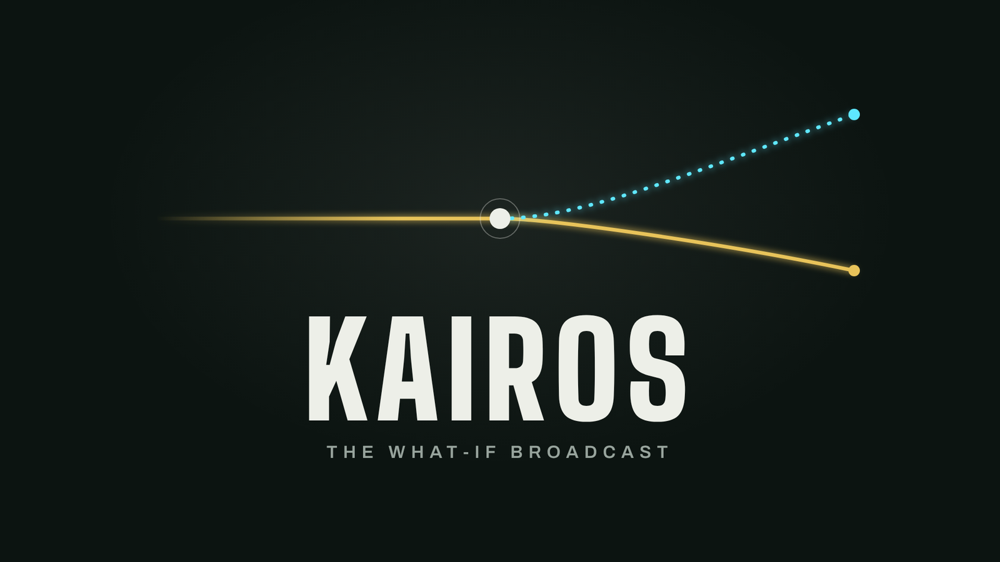
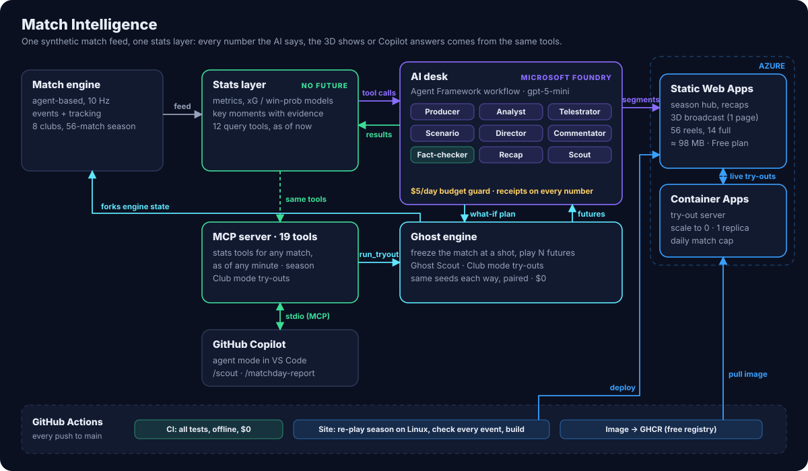

# Kairos



**Kairos** (Greek for *the decisive moment*) is an AI football broadcast that explains every key moment, proves every
number, and plays out what could have happened. Nine AI agents built with **Microsoft Agent Framework** on
**Microsoft Foundry** run a personalised 3D broadcast of a simulated season; a match engine settles "what if"
arguments by replaying the match from the exact moment, many times over; and clubs use the same engine to try any
player in any position, including from **GitHub Copilot** through our MCP server.

> Other tools tell you what happened. Kairos shows you what could have happened, and proves it.

**[Watch the 2-minute video](https://youtu.be/FCv4CNPWJLw)** · **[Try it live](https://icy-grass-0e64d851e.5.azurestaticapps.net)** · [Architecture](#architecture) ·
[Copilot demo](docs/COPILOT_DEMO.md) · [Deploying](docs/DEPLOY.md)

Built for the Microsoft x Premier League *Inside the Game* hackathon (Best Multi-Agent System). All data is
synthetic: the Meridian League's clubs, players, managers and stadiums are fictional.

## Try it in 2 minutes

[Open Kairos](https://icy-grass-0e64d851e.5.azurestaticapps.net) in your browser; there is nothing to install.

1. Click **Watch the 3D broadcast**. The AI desk covers every key moment; at a "what if" the picture splits into what
   happened (gold) and the simulated future (cyan).
2. Pick a style, a language, your club and your player (press **Y** to change them). Same match, your own edition.
3. Press **R** on any line of commentary for its receipts, including the drafts the Fact-checker rejected, and **D** to
   see what each agent did.
4. Press **C** for Club mode: try any player in any position and see, with a margin of error, whether he makes the
   team better.
5. Back on the home page: the table, all 56 matches with 3D highlights, and a fact-checked report for every match.

## What it does

**Plays out what could have happened.** At a goal, a great save or a big chance, the Scenario agent asks the match
engine "what if?". The engine freezes the match the instant the shot is struck and plays it to full time dozens of
times with the outcome flipped and as it happened, on the same random streams, so the difference is that one moment.
The 3D broadcast splits reality (gold) from the simulated future (cyan), cuts into the ghost timeline with the real
player models, and ends on a verdict with its margin of error. From the demo match: had Mensah's 85th-minute shot gone
in at 1-1, Riverside win 85% of 40 simulated futures and Kingsport none. Kingsport won 2-1.

**Your broadcast.** One match, every viewer's own edition. Pick a style (Fan, Analyst, Tactician, Academy), a language
(English, Spanish, French), your club and your player: the live cameras, replays, graphics and commentary all change.
Commentary is written natively in each language and fact-checked in that language; each club's fans get their own
channel; the Academy edition coaches the decision at the key moment; player focus keeps your player in shot with his
live stat line. That makes 18 editions of every big moment.

**Commentary with receipts.** Click any line (or press R) to see where every fact came from: each number matched to
its source, the tool call and result field behind each fact, the match events it cites (one click jumps the 3D view
there), and the fact-check history, rejected drafts included. Analysts also get a shot map, an xG race and a pass
network built from the match so far (press G).

**A whole season.** The season hub has the table (actual and expected points), the points race, results, players and
clubs. All 56 matches have 3D highlights, each matchday's match of the week plays in full, and every match report has
a recap and a simulated "what decided it?".

**Club mode.** Try any player in the league in any position. The fixture is played many times with him and many times
with the player who really starts there, on the same seeds: expected points, xG for and against, his per-90 line
against the starter's, an honest margin of error, and the Scout agent's verdict (sign, shortlist or pass). Watch his
best moment in 3D, or simulate anyone on demand.

**In GitHub Copilot.** An MCP server with 19 tools puts the season, every match (as of any minute) and Club mode
inside VS Code. `/scout` runs a live try-out on our engine; `/matchday-report` writes a report from the tools.

## The agents

Nine agents, each with one job, all on Microsoft Foundry. Seven work every key moment as a Microsoft Agent Framework
workflow; they share one ledger of tool results, and nothing airs until it has passed the fact-check.

| Agent | Job |
|---|---|
| **Producer** | Decides whether a moment airs, its angle, and which specialists to call |
| **Analyst** | Researches the moment with the stats layer's 12 tools; never calculates a number itself |
| **Telestrator** | Chooses what to draw on the replay; code pins each shape to where players really were |
| **Scenario agent** | Turns a "what if" into a precise intervention that the match engine simulates |
| **Director** | Calls the live camera, the replay sequence and the on-screen graphic, per viewing style |
| **Commentator** | Writes the lines for each style, club channel and language, from the Analyst's facts only |
| **Fact-checker** | The gate: code checks every number against the ledger, then a model reviews every claim; one rewrite, then the stats layer's verified title airs instead |
| **Recap** | Writes each season match's report and what decided it, checked the same way |
| **Scout** | Writes the verdict on each Club mode try-out; every number code-checked against the try-out |

**In the live run** (gpt-5-mini; 10 moments × 18 editions; 561 model calls; $1.33 in total): 73 of the 180 first
drafts (41%) were rejected, 31 by code checks and 42 by the Fact-checker. 52 passed after one rewrite and 21 fell back
to verified facts, so 107 editions were approved first time. Nothing unverified aired. Every model
call passes a budget guard that refuses to spend past a daily cap ($5 by default), and every paid command asks first.

## Architecture



One synthetic feed and one stats layer: every number the agents say, the 3D shows or Copilot answers comes from the
same tools. The site is static (Azure Static Web Apps); Club mode's live try-outs run on the match engine in Azure
Container Apps (scale to zero); the AI desk runs on Microsoft Foundry and its fact-checked results are committed, so
the public site never calls a model. GitHub Actions tests every push and rebuilds the site on Linux, re-playing the
season and checking every match event for event.

| Microsoft technology | Used for |
|---|---|
| Microsoft Foundry | Model deployments for all nine agents (gpt-5-mini) |
| Microsoft Agent Framework | The desk's workflow: fan-out and fan-in, the revision loop, the budget-guard middleware |
| GitHub Copilot + MCP | 19 tools in agent mode; ready-made `/scout` and `/matchday-report` prompts |
| Azure Static Web Apps | The season hub and the 3D broadcast for 56 matches |
| Azure Container Apps | The live try-out server (engine only): scale to zero, 1 replica, daily cap |
| GitHub Actions | Tests on every push; the Linux site build and deploy; the try-out server image |

## Built to be trusted

- **No future knowledge.** Matches are replayed as if live; the stats tools answer as of the moment being covered (tested).
- **Receipts for every claim.** Every moment lists the events that prove it; every tool call and result is on a ledger.
- **Published accuracy.** The xG model scores AUC 0.886 on 33 matches it never saw; the win-probability model's error is 37% below a league-average baseline ([report](docs/MODEL_REPORT.md)).
- **Honest simulations.** Paired futures on the same random streams, with a margin of error stated every time.
- **Graceful failure.** A model error, a rejected draft or a spent budget degrades to verified facts, never a crash.
- **100 tests** across the three packages, run on every push.

## Run it locally

Python 3.11 or newer. From the repo root, in a virtual environment:

```
pip install -e "./engine[dev]" -e "./stats[dev,mcp]" -e "./agents[dev]"
cd engine && pytest && cd ../stats && pytest && cd ../agents && pytest && cd ..
```

**One match in 3D with the AI desk**, on any machine:

```
cd agents
matchagents render ../data/demo/riv-kin-1119 editions-live.json     # open the page it prints; try Y, D, C, G and R
```

**The whole website** (no AI calls, $0). The 3D data needs the season re-played with tracking, which reproduces
exactly on Linux (use WSL on Windows), as in CI:

```
cd engine
matchengine season --out ../data/season --demo ../data/demo/riv-kin-1119 --tracking ../data/matches/season   # ~15-30 min
cd ../agents
matchagents site --season ../data/season --demo ../data/demo/riv-kin-1119 --segments editions-live.json \
  --recaps recaps-live.json --tracking ../data/matches/season --out ../site
cd ../site && python -m http.server 8000          # open http://localhost:8000
```

**The AI desk with real models** needs `AZURE_OPENAI_ENDPOINT` and `AZURE_OPENAI_API_KEY` in the environment (never in
code). Every paid command shows the models, the estimated cost and today's remaining budget, and asks first;
`--offline` runs the same pipeline with rule-based agents for $0.

```
cd agents
matchagents editions ../data/demo/riv-kin-1119 --offline --out editions.json          # $0 preview
matchagents editions ../data/demo/riv-kin-1119 --futures 40 --out editions-live.json  # real models, ~$1.50, resumable
matchagents recaps ../data/season --out recaps-live.json                              # ~$0.45
matchagents spend                                                                     # today's spending
```

**Club mode and Copilot:**

```
cd engine
matchengine tryout --home RIV --away KIN --side home --position ST --player wes-20 --n 12 --cache ../data/demo/riv-kin-1119/tryouts
matchengine serve --cache ../data/demo/riv-kin-1119/tryouts     # live try-outs: open the 3D page with ?api=http://127.0.0.1:8765
matchstats mcp                                                   # the MCP server; VS Code starts it from .vscode/mcp.json
```

Each package's README has its full command list: [`engine/`](engine/README.md), [`stats/`](stats/README.md),
[`agents/`](agents/README.md). Deploying to Azure: [`docs/DEPLOY.md`](docs/DEPLOY.md).

## Repository layout

```
engine/       the match engine, ghost futures, Club mode try-outs, the season (package `matchengine`)
stats/        stats layer, trained models, key moments, query tools, the 3D viewer, the season hub,
              the MCP server (package `matchstats`)
agents/       the nine agents on Microsoft Foundry, recaps, the website build (package `matchagents`);
              editions-live.json and recaps-live.json hold the live run's fact-checked output
data/sample/  one complete simulated match, used by the tests
data/demo/    the demo match (Riverside 1-2 Kingsport) with its ghost checkpoints and 44 Club mode try-outs
data/season/  the 2026/27 season: 56 match bundles, season.json, each match's turning point and what-if
deploy/       the try-out server's container image
docs/         deploying, the Copilot demo, event schema, model accuracy, engine calibration
.github/      CI, the site build and deploy, the image build, Copilot prompt files
```

## How it meets the brief

| Stage of the challenge | Where |
|---|---|
| Ingest synthetic match events as they happen | [`engine/`](engine/): an agent-based 10 Hz simulator with a live feed; 8 fictional clubs; calibrated against real-world ranges |
| Interpret into stats, patterns and context | [`stats/`](stats/): 9 live metrics; trained xG, pass-difficulty and win-probability models; 18 kinds of key moment with evidence |
| Explain why moments matter | [`agents/`](agents/): nine agents on Microsoft Foundry, fact-checked, with receipts |
| Render on screen alongside the match | The 3D broadcast: AI director, replays, telestration, ghost timeline, analyst boards, control room |
| Personalise for different fans | Four styles, three languages, club channels, player focus: 18 fact-checked editions per moment |
| Beyond the brief | What-if simulations, Club mode recruitment, a whole season in 3D, GitHub Copilot through MCP |

## Team

Built by [Sanmay Mangal](https://github.com/SanmayMangal) and [Ryan](https://github.com/rjlopez8-rgb). MIT License.
