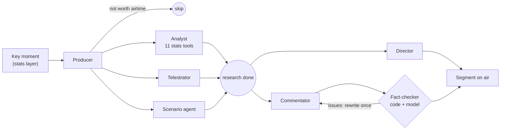

# matchagents: the AI broadcast desk

Seven agents turn each key moment into a broadcast segment: what is said, which cameras cut, what is drawn on the pitch, and what would have happened otherwise. They run as a **Microsoft Agent Framework** workflow on models deployed in **Microsoft Foundry**, and nothing reaches the screen until it has passed the fact-check.



| Agent | Job | Output |
|---|---|---|
| **Producer** | Decides whether the moment airs, the angle, and which specialists to call. Keeps a rundown so it does not repeat itself (one "what if" per half). | `ProducerPlan` |
| **Analyst** | Researches the moment with the stats layer's 11 tools. Never calculates a number itself. | `AnalystBrief`: facts with values, source tool and evidence event ids |
| **Telestrator** | Chooses what to draw on the replay (rings, arrows, runs, zones). Code pins each shape to where players really were, from tracking data. | `Telestration` plus pitch coordinates |
| **Scenario agent** | Turns a "what if" into one precise intervention, which the match engine then simulates: paired ghost futures ("what if it had gone in / been saved?") or Ghost Scout (the same chance taken by every attacker in the league). | `ScenarioSpec` plus simulated results |
| **Director** | Calls the live camera, the replay sequence (with slow motion) and the on-screen graphic for the 3D viewer. | `DirectorCue` |
| **Commentator** | Writes 1-3 lines for the viewer's style (fan, tactician, analyst, academy), favourite team and language, using only the Analyst's facts. | `Commentary` |
| **Fact-checker** | The gate. First code: every number, percentage, minute and score must exist in the stats layer's results. Then a model review of every claim. One rewrite is allowed; after that the stats layer's own factual title airs instead. | `Verdict` |
| **Recap** (season matches) | Writes each season match's headline, recap and what decided it, from the season report and the turning-point simulation. Same checks as the commentary, then the Fact-checker's review. | `MatchRecap` |

## Why it can be trusted on air

- **No future knowledge.** The match is replayed as if live, and the stats tools answer as of the moment being covered (tested).
- **Receipts.** Every tool call and its exact result is recorded in a ledger; the fact-checker only accepts numbers that appear in it.
- **Strict outputs.** Every agent returns a Pydantic model enforced by the API's strict JSON schema, so a malformed answer cannot break the broadcast.
- **Graceful failure.** A model error, a rejected draft or a spent budget degrades the segment to verified facts; it never crashes the broadcast.

## Spending safeguards

Every single model request passes through `BudgetMiddleware`:

1. **Before** the request, the budget guard estimates its cost (prices rounded up, unknown models priced as the most expensive) and refuses if today's spend would pass the cap. Nothing is sent.
2. **After** the response, the real token counts are recorded in `~/.match-intelligence/usage.json`.
3. Live runs show the models, the estimate and the remaining budget, and ask for confirmation first.

The cap is `MATCH_DAILY_CAP_USD` (default $5). With gpt-5-mini a moment costs about 1-3 cents (8 model calls, most of it reasoning tokens).

## Run it

```powershell
pip install -e ../engine -e ../stats -e ".[dev]"
python -m pytest                                                     # no network, $0

matchagents match ../data/sample/riv-kin-7 --offline                 # whole match with rule-based agents, $0
matchagents cover ../data/sample/riv-kin-7 --moment riv-kin-7-m044   # the 74' goal with real models (a few cents)
matchagents match ../data/sample/riv-kin-7 --limit 3 --style academy --out segments.json
matchagents cover ../data/sample/riv-kin-7 --moment riv-kin-7-m044 --futures 40   # with 40 ghost futures
matchagents render ../data/sample/riv-kin-7 segments.json            # 3D broadcast that plays the desk's segments
matchagents recaps ../data/season --out recaps-live.json             # every season match's recap (asks first)
matchagents spend                                                    # today's spending
matchagents diagram                                                  # the workflow as Mermaid
```

Needs `AZURE_OPENAI_ENDPOINT` and `AZURE_OPENAI_API_KEY` as environment variables (never in code).

## Choosing models

Every agent reads its deployment from the environment, so a model swap is a setting:

```powershell
$env:MATCH_MODEL = "gpt-5-mini-1"            # default for every agent
$env:MATCH_MODEL_ANALYST = "gpt-6-sol-1"     # override one agent
```

The final per-agent choice comes from the evaluation harness (next step), not from guesswork.

## Layout

```
src/matchagents/
  desk.py      the workflow: executors for the seven agents, fan-out/fan-in, the fact-check loop
  prompts.py   each agent's instructions
  schemas.py   each agent's strict output
  tools.py     stats queries as agent tools, with the receipts ledger
  checks.py    code-side number check and telestration coordinates
  session.py   replays a match as if live (no future knowledge)
  llm.py       Foundry client, budget middleware, trace, scripted client
  ghost.py     runs the Scenario agent's plan through the engine (ghost futures, Ghost Scout)
  offline.py   rule-based agents for $0 runs and tests
  budget.py    the spending guard
  config.py    model per agent
  cli.py       `matchagents` command
tests/         wire format to Foundry, budget cap, fact-check, telestration, full desk
```
