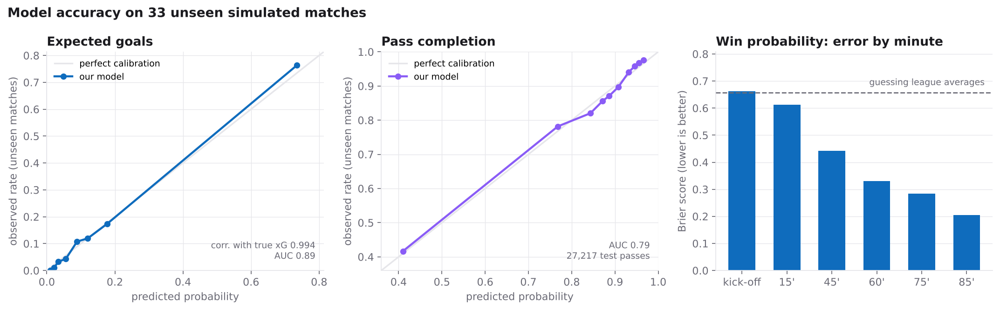

# Model accuracy report

Trained on 135 simulated matches, evaluated on 33 **unseen** matches.
Ground truth comes from the match engine's own probabilities, which the models never see.

## Expected goals (xG)

| Metric | Value |
|---|---|
| Test shots | 739 |
| Goals scored vs. our xG total | 116 vs. 115.2 |
| Correlation with true chance quality | 0.994 |
| Mean absolute error vs. true xG | 0.0205 |
| Brier score (ours / true xG) | 0.0768 / 0.0759 |
| AUC (goal vs. no goal) | 0.886 |

## Pass difficulty (completion model)

| Metric | Value |
|---|---|
| Test passes | 27,217 |
| Observed vs. predicted completion | 84.9% vs. 84.9% |
| Correlation with true completion probability | 0.519 |
| Mean absolute error vs. true probability | 0.0699 |
| AUC on passes the engine models (ours / engine) | 0.772 / 0.758 |
| AUC on all passes incl. set pieces | 0.79 |

## Win probability

| Metric | Value |
|---|---|
| Test game states | 3,988 |
| Brier score (ours / always-predict-league-average) | 0.4114 / 0.6574 |
| Log loss | 0.7074 |
| At kick-off: Brier / accuracy | 0.6621 / 32% |
| At 15': Brier / accuracy | 0.6132 / 43% |
| At 45': Brier / accuracy | 0.442 / 63% |
| At 60': Brier / accuracy | 0.3311 / 83% |
| At 75': Brier / accuracy | 0.2835 / 80% |
| At 85': Brier / accuracy | 0.2056 / 90% |

Lower Brier and log loss are better. AUC of 0.5 is random and 1.0 is perfect. The engine's probabilities are its decision-time estimates, made before execution error and defender reactions, so a model trained on outcomes can outrank them.
