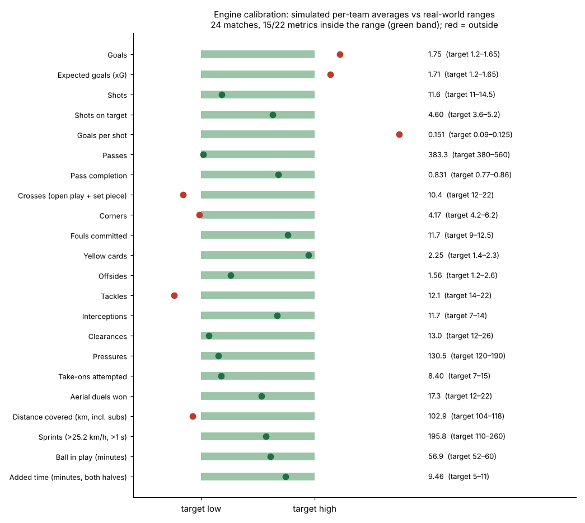

# matchengine: synthetic football match engine

`matchengine` simulates complete, football-realistic matches and streams them as a live data feed: **events** (passes, shots, tackles, pressure, possession changes and more) plus **tracking frames** with every player's and the ball's position at up to 10 Hz.

It is the data source for the rest of Kairos: everything downstream (stats, agents, the 3D broadcast) consumes this feed exactly as it would consume an official match-data provider. The same engine also plays out **what could have happened** (ghost futures), **tries any player in any position** (Club mode) and generates **a whole season** of 56 matches.

```
pip install -e ".[dev]"
matchengine simulate --home RIV --away KIN --seed 7 --out ../data/matches/riv-kin-7
matchengine stream --speed 10            # live JSON-lines feed on stdout
```

## Why a simulator, not random events

Random event generators produce data with no football inside it. This engine produces data with real structure, so the AI layer has something genuine to find and explain:

- **22 autonomous players at 10 Hz.** Each has acceleration, top speed, stamina and fatigue, and moves towards tactically computed positions. Distance, high-speed running, sprints and top speeds come out of the physics, not out of a random number generator.
- **Decision-making with perception.** The player on the ball evaluates every option (passes to feet, through balls, lofted passes, crosses, shots, carries, take-ons, holding, clearing) by expected possession value. Perception noise depends on the player's vision and fatigue, so tired or low-vision players make worse choices.
- **Physical outcome models.** Interceptions are races between ball and defender. Shots go through blockers, pressure, finishing and goalkeeper models. Aerial balls become contested duels.
- **Team tactics that create patterns.** Formation, pressing intensity, line height, width, tempo, directness, risk appetite and crossing preference all shape the match. Managers change tactics when chasing or protecting a lead, make substitutions for fatigue and tactics, and react to red cards.
- **A full match around the play:** throw-ins, corners, goal kicks, free kicks, penalties, offsides, fouls, yellow and red cards, substitutions, added time and half-time.
- **Scripted scenarios** inject red cards, injuries, tactical switches, momentum swings or penalties at chosen minutes, and a seed search finds matches that follow a storyline (e.g. "home team trails at 55' and wins").
- **Ground truth for evaluation.** Every pass carries the engine's true success probability and every shot its true xG, under `details.truth`. Downstream models can be scored against what really generated the data.

## The fictional Meridian League

Eight invented clubs with distinct tactical identities. Every player, manager and stadium is fictional; no real teams, players or trademarks are used.

| Code | Club | Formation | Identity |
|---|---|---|---|
| RIV | Riverside Athletic | 4-3-3 | High-press possession (showcase club) |
| KIN | Kingsport United | 4-2-3-1 | Low-block counter-attack (showcase club) |
| NGC | Northgate City | 4-3-3 | Positional possession, strongest squad |
| CRW | Crowmoor Wanderers | 3-4-3 | Chaotic gegenpress |
| ELM | Elmhurst Albion | 4-2-3-1 | Balanced |
| ASH | Ashvale Rovers | 4-4-2 | Wing play and crosses |
| WES | Westmere Town | 3-5-2 | Compact back three |
| SAL | Saltmarsh FC | 4-4-2 | Deep block, long balls |

The showcase clubs have hand-written stars with storylines the narrative agents can use. Examples: Kwame Mensah (RIV captain, four matches without a goal) and Rafael Duarte (KIN striker facing his former club). `matchengine league` lists them all.

## Commands

| Command | What it does |
|---|---|
| `matchengine league` | List clubs, formations, styles and star players |
| `matchengine simulate --home RIV --away KIN --seed 7 --out DIR` | Simulate a match and write a bundle |
| `matchengine stream --speed 1 [--frame-hz 5] [--scenario FILE]` | Live feed on stdout (`speed` 1 = real time, 10 = 10x, 0 = unpaced) |
| `matchengine scenario scenarios/red_card_turnaround.json --out DIR` | Run a scripted scenario |
| `matchengine find-seed scenarios/showcase.json --tries 100` | Find a seed whose match follows the scenario's storyline |
| `matchengine calibrate --matches 24` | Compare simulated averages with real-world ranges |
| `matchengine season --out ../data/season --demo ../data/demo/riv-kin-1119` | Simulate the full season (56 matches, resumable, parallel) |
| `matchengine season ... --tracking ../data/matches/season` | Re-play every season match with tracking for the 3D site, checked event for event against the committed season |
| `matchengine tryout --home RIV --away KIN --side home --position ST --player wes-20 --n 12 --cache DIR` | Club mode: a candidate against the real starter over paired matches |
| `matchengine board --home RIV --away KIN --n 12 --cache DIR --out board.json` | Recruitment board: rank every candidate for every position, pre-simulate two per position |
| `matchengine serve --cache DIR` | Live try-out server for the 3D page (engine only, one job at a time, daily cap) |
| `matchengine schema --out ../docs/schema` | Export JSON Schemas for events, frames and details |

From Python:

```python
from matchengine import simulate_match, SyntheticFeed, MatchConfig, get_club

result = simulate_match("RIV", "KIN", seed=7)            # events, frames, meta, summary
for kind, item in SyntheticFeed(MatchConfig(home=get_club("RIV"), away=get_club("KIN"), seed=7), speed=0):
    ...                                                   # ("meta" | "event" | "frame", payload)
```

## Ghost futures: what could have happened

The engine is deterministic for a seed, so a recorded match can be replayed exactly up to any shot. At that instant
the whole match state is frozen (positions, fatigue, cards, tactics, the ball in flight) and copied many times. Each
copy gets its own random stream and plays to full time:

- **What if it had gone in, or been saved?** The shot's outcome is changed the way the engine changes its own, and the
  same random streams run with and without the change, so the difference between the two sets of futures is that one
  moment. Results come with a 95% margin of error, a win-probability curve per future, and a featured future replayed
  with tracking for the 3D ghost timeline.
- **Ghost Scout: who would have scored it?** The engine's shot model is re-run for the exact same chance (position,
  pressure, keeper, lane) with every attacker in the league.

Exact replay depends on floating-point details that differ between platforms, so frozen states are recorded on the
machine that generated the match and shipped with it (`ghost_checkpoints.pkl.gz`, and each season match's turning
point in `data/season/turning_forks.pkl.gz`); any machine can then play futures from them.

```python
from matchengine.ghost import load_checkpoint, what_if_shot
fork = load_checkpoint("../data/demo/riv-kin-1119", shot_event_id)
result = what_if_shot(meta, shot_event, "shot_scores", n=40, fork=fork)   # with_change, as_it_happened, curves, featured
```

## Club mode: try any player in any position

`tryout.py` puts a candidate into a copy of the club in place of the starter and plays the fixture `n` times with him
and `n` times with the starter, on the same seeds (the tried position is protected from substitutions in both). The
result: expected points from every shot's xG (low noise), results, xG for and against, the player's per-90 line
against the starter's, and paired differences with 95% margins and a "clear" flag. Runs are cached per seed, so the
starter's runs serve every try-out in that position. The board ranks every candidate by an attribute projection for
the role and pre-simulates the top projected and best under-23 player per position, each with a clip of his best
moment. `matchengine serve` streams new try-outs to the 3D page one match at a time.

## The season

`season.py` builds a double round robin of the eight clubs (14 matchdays, 56 matches, weekly from 12 September) with
the demo match on its own date, and simulates it in parallel. The committed bundles are small (no tracking). For the
3D site, `--tracking` re-plays every match on its seed with 5 Hz tracking and compares it with the committed match event
for event; any difference stops the run with an explanation, so the 3D can never show a different game from the table.

## Output: a match bundle

| File | Contents |
|---|---|
| `meta.json` | Match id, competition, venue, referee, weather, both teams' lineups, benches, full squads with attributes, tactics, attacking directions |
| `events.jsonl` | One event per line in publication order |
| `tracking.jsonl.gz` | One frame per line: ball `{x, y, z, speed_ms, state, owner_id}` and `[player_id, x, y, speed]` for all 22 players |
| `summary.json` | Ground-truth box score and per-player physical and technical stats |

Events are published **when their outcome is known**, just like a live provider feed (a pass appears once it is received or lost). `t` is when the action started and `seq` is the publication order. The full contract is in [`../docs/EVENT_SCHEMA.md`](../docs/EVENT_SCHEMA.md) and is enforced by tests.

## Realism: calibration

`matchengine calibrate` simulates a round of fixtures and compares per-team averages with typical top-flight ranges. Current result over 24 matches: **15 of 22 metrics inside the real-world range, and the rest within a few percent of it.**



Highlights: ~384 passes per team at 83% completion, 11.6 shots per team, 4.6 on target, 1.7 xG, 11.7 fouls, 2.25 yellow cards, 57 minutes of ball in play, 9.5 minutes of added time, and ~196 sprints per team. Full-match outfielders cover around 10 km with top speeds of 31–34 km/h. Results split 46% home wins / 21% draws / 33% away wins at 3.5 goals per match.

Known gaps, all within a few percent of their ranges: slightly high scoring (1.75 vs ≤1.65 goals per team), slightly few crosses, tackles and corners, and distance covered ~1% under range.

## How it maps to the hackathon rules

| Rule requirement | Where it is met |
|---|---|
| Ingest synthetic match events *as they happen* | `SyntheticFeed` / `matchengine stream` publishes paced events in real time |
| Passes, shots, tackles, possession changes, pressure events, match metadata | Dedicated event types for each, plus `meta.json` |
| Player identification, speed and distance indicators | Tracking frames carry every player's id, position and speed at 10 Hz; `summary.json` has distance, HSR, sprints, top speed |
| Pass distance, accuracy, difficulty | `length_m`, `outcome`, `under_pressure`, `nearest_opponent_m`, `release_speed_kmh`, plus true success probability for validating a difficulty model |
| Ball speed and shot speed | `ball.speed_ms` in every frame, `release_speed_kmh` on passes, `speed_kmh` on shots |
| Data innovation: create synthetic football-realistic datasets | The engine, the fictional league, scenarios and calibration report are the contribution |
| Synthetic data only, no real footage or third-party data | Everything is generated; no real teams, players or trademarks |
| Auto-eventing from video | Deliberately out of scope. It needs licensed footage and the rules list it only as a "consider" item. Our tracking stream plays the role that optical tracking plays in production |

Production path: `MatchFeed` is a protocol. Swap `SyntheticFeed` for an adapter over an official event and tracking provider and nothing downstream changes.

## Project layout

```
src/matchengine/
  engine.py        main loop: clock, ball, possession, duels, set pieces, discipline, subs, frames
  ghost.py         frozen match states at shots, paired ghost futures, Ghost Scout
  tryout.py        Club mode try-outs, recruitment boards, best-moment clips
  serve.py         live try-out server (HTTP, streams one JSON line per finished match)
  season.py        the 56-match season and its tracking re-play
  summary.py       box score from a finished match
  io.py            writing and reading match bundles
  decisions.py     on-ball decision model (vectorised option evaluation)
  tactics.py       team shape, pressing, cover, marking, runs, set-piece setups
  probability.py   xG, pass interception races, position value
  league.py        fictional clubs and squads
  scenario.py      scripted incidents and storyline seed search
  stream.py        real-time feed (MatchFeed protocol)
  schema.py        Pydantic data contract + JSON Schema export
  calibration.py   realism report
  params.py        every tunable constant in one place
scenarios/         showcase, red-card turnaround, injury, goal-fest, tactical battle
tests/             contract and behaviour tests (pytest)
```

## Development

```
pip install -e ".[dev]"
pytest              # 37 tests
ruff check src tests
```

A full 90-minute match simulates in about 15 to 30 seconds per CPU core. Same seed, same platform, same match: everything is deterministic.
