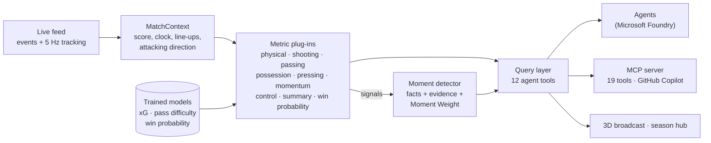

# matchstats: the Interpret stage (and what fans see)

`matchstats` turns the live match feed into numbers an AI agent can trust. It reads events and tracking frames as they arrive, keeps 9 families of metrics up to date, and detects the **key moments** worth talking about. It then answers agents' questions through 12 small, typed queries.

It also holds everything on screen: the **3D broadcast** (one viewer for every match), the **season hub**, and the
**Kairos MCP server** that puts the same tools in GitHub Copilot.

Agents never calculate a statistic themselves. They ask `matchstats`, and every answer carries the **event ids that prove it**. That is what lets the commentary show its receipts and lets the fact-checker agent verify every claim.



## What it guarantees

| Guarantee | How it is enforced |
|---|---|
| **No cheating with simulator truth.** Models only see what a real data feed would contain. | A test strips every `details.truth` field from the feed and requires a byte-identical snapshot and moment list. |
| **Every claim has receipts.** | Every moment lists its evidence event ids. A test checks that each one exists and happened before the moment. A penalty's receipts start at the foul, not the open play before it. |
| **Live and replay give the same answers.** | Moments streamed item by item must equal a batch run over the same feed (tested). |
| **Published accuracy.** | Models are evaluated on matches they never saw. See [Model accuracy](#model-accuracy). |
| **Stable contracts for agents and UI.** | Pydantic models for moments and snapshots, exported as JSON Schema; every tool has a JSON-schema parameter spec. |
| **Fast enough for live use.** | A full match (≈32,000 feed items) is analysed in about 1.5 s on a laptop, roughly 4,000× real time. |

## Quick start

```bash
cd stats
pip install -e ../engine -e ".[dev]"

matchstats analyze ../data/sample/riv-kin-7              # full-time report
matchstats live --home RIV --away KIN --seed 7           # moments as they happen
matchstats replay ../data/sample/riv-kin-7               # 2D replay page you can open in a browser
matchstats replay ../data/sample/riv-kin-7 --3d          # 3D broadcast with the auto director
matchstats ask ../data/sample/riv-kin-7 explain_moment --args '{"moment_id": "riv-kin-7-m044"}'
matchstats tools                                         # the agent tool catalogue
matchstats season ../data/season --out season.html       # the season hub on its own (the website build uses it too)
matchstats mcp                                           # the MCP server (stdio; --http for streamable HTTP)
pytest                                                   # 36 tests
```

```python
from matchstats import MatchAnalyzer, replay_bundle
from matchstats.queries import MatchQueries

analyzer = MatchAnalyzer()
for kind, item in replay_bundle("../data/sample/riv-kin-7"):
    for moment in analyzer.process(kind, item):  # new moments, the instant they are detected
        print(moment["minute_display"], moment["title"])

q = MatchQueries(analyzer)
q.momentum()  # who is on top, the trend, and what is driving it
q.player_stats("Duarte")  # names are resolved fuzzily, so typos are fine
```

## Metrics

Each metric is a plug-in that updates on every event (and frame), so a snapshot is always current.

| Plug-in | What it measures |
|---|---|
| `physical` | Distance, high-speed running (> 19.8 km/h), sprints (> 25.2 km/h for 1 s+) and top speed per player, from tracking frames. Raises speed alerts (33+ km/h) and distance milestones. |
| `shooting` | **Expected goals** from our trained model; shots, big chances, goalkeeper goals prevented, an xG timeline, and the fastest shot. |
| `passing` | **Pass difficulty (0–10)** from our completion model, plus progressive passes, opponents bypassed (lines broken, from tracking), key passes, assists, crosses, through balls, accuracy under pressure, and **pass networks**. |
| `possession` | Possession share by ball-in-play time, field tilt, final-third and box entries, zone touches (6×3 grid), and possession sequences (longest, average passes, ending in a shot). |
| `pressing` | Pressures by third, **PPDA**, high turnovers and a pressing pulse. |
| `momentum` | Decayed attacking threat (4-minute half-life) folded into one index from −1 (away on top) to +1 (home on top). |
| `control` | A **chaos index (0–100)** from turnovers, duels and scrambles, scaled to levels learned from simulated matches; team control, tempo and stoppages. |
| `summary` | The box score: goals, cards, fouls, corners, tackles, aerials, dribbles, saves and substitutions. |
| `win_probability` | Live home/draw/away probabilities and **Moment Weight** for each goal, red card and big chance. |

### Moment Weight

Moment Weight is the number of percentage points of win probability a moment moved: it puts a single number on how much a moment changed the match.

- **Goals and red cards** use the realised swing. Duarte's 74' penalty moved Kingsport's chances by 48 points.
- **Missed chances** use the expected swing: the swing a goal would have caused, multiplied by the chance's xG. A sitter missed at 0-0 in the 85th minute outweighs a speculative shot at 4-0.

## Key moments

Moments are factual, not prose. Writing the commentary is the agents' job. Each moment carries `facts`, `evidence`, `moment_weight` and an `importance` (0–1) for prioritising overlays.

| Driven by events | Driven by metric signals |
|---|---|
| goal, big chance (incl. missed penalty), great save, penalty awarded, red / yellow card, tactical change, substitution, half-time / full-time summary | speed alert, new top speed, distance milestone, line-breaking pass, long passing sequence (25+), possession dominance, pressing surge, momentum shift, chaos spike |

## Agent tools

`MatchQueries` exposes one method per tool; `matchstats.queries.TOOLS` holds descriptions and JSON-schema parameters, ready to register with an MCP server or Foundry function calling.

| Tool | Answers |
|---|---|
| `scoreboard` | Score, clock, headline numbers, win probability, goals |
| `team_comparison` | Side-by-side stats in groups: attack, possession, passing, defending, physical, discipline |
| `player_stats` | Everything about one player, plus their moments |
| `top_players` | Leaderboard for any player stat, optionally for one team |
| `momentum` | Who is on top, the trend over a window, and what is driving it |
| `moments` | Filtered moments by type, team, player, minute or importance |
| `explain_moment` | One moment's facts plus its evidence events in readable form |
| `event` | One feed event with the stats layer's analysis attached |
| `win_probability` | Current probabilities, trend and the biggest swings |
| `pass_network` | Average positions and most frequent passing links |
| `timeline` | Per-minute series for charts (xG, possession, momentum, pressing, control, win probability) |
| `options` | The decision at a shot or pass: every teammate's space, pass completion and xG from his spot, and whether a better option was on (used by the Academy edition) |

## The 3D broadcast

`viewer/broadcast.html` is one self-contained page (three.js) that plays any match: the demo match in full with its AI
desk, every season match's highlights, and each matchday's match of the week in full. It has an auto director
(cameras, replays with slow motion, telestration pinned to tracking data), the viewer's edition (style, language,
club channel, player focus), the ghost timeline for what-ifs (reality in gold, the simulated future in cyan),
**receipts** for every commentary line (press R: each number matched to its tool call and result field, the evidence
events with a jump to each, the fact-check history), **analyst boards** built from the match so far (press G: shot
map, xG race, pass network), a control room, and Club mode (try-out results, the best-moment clip, live try-outs
from the engine server). `matchstats replay --3d` builds it for one bundle; `matchagents site` builds it for the season.

## The season hub

`season.py` turns `matchengine season` into one page (`viewer/season.html`): the table with actual and expected
points, the points race, results by matchday, match reports (box score, win-probability chart, the AI recap and the
simulated "what decided it?"), player and club pages, and links into each match's 3D.

## MCP server: Kairos in GitHub Copilot

`mcp_server.py` (`matchstats mcp`, configured in the repo's `.vscode/mcp.json`) serves 19 tools built on the
official MCP Python SDK: the 12 match tools above for any season match **as of any minute** (the match is replayed
to that minute, so answers never know the future), 4 season tools (`list_matches`, `league_table`,
`season_player`, `what_decided_it`) and 3 Club mode tools (`tryout_board`, `tryout_result`, and `run_tryout`, which
runs a real try-out on the match engine with progress updates, $0 and capped per server). Walkthrough:
[`docs/COPILOT_DEMO.md`](../docs/COPILOT_DEMO.md).

## Model accuracy

Trained on 135 simulated matches and tested on 33 matches the models never saw. The simulator knows the true probability behind every shot and pass, so unlike real-world models these can be checked against the truth. Full report: [`docs/MODEL_REPORT.md`](../docs/MODEL_REPORT.md).


| Model | Used for | Result on unseen matches |
|---|---|---|
| **Expected goals** | chance quality, big chances, Moment Weight | 0.994 correlation with true chance quality; 115 goals predicted vs. 116 scored over 739 shots |
| **Pass completion** | pass difficulty (0–10), hardest passes | predicted 84.9% completion vs. 84.9% observed over 27,217 passes; AUC 0.77 vs. 0.76 for the engine's own decision-time estimate |
| **Win probability** | live odds, Moment Weight | 37% lower error (Brier) than guessing league averages; 90% of results called correctly from the 85th minute |

All three models are small, explainable logistic models written in NumPy, so there is no GPU or cloud cost. Their weights ship as JSON inside the package. Retrain with:

```bash
python scripts/generate_training_data.py --matches 168 --out ../data/training   # ~30 min on 2 cores
matchstats train ../data/training --report ../docs/MODEL_REPORT.md               # ~10 s
```

## Layout

```
src/matchstats/
  analyzer.py     MatchAnalyzer: the single entry point
  context.py      incremental match state, attacking-direction normalisation
  feed.py         replay a recorded bundle or follow a live simulated match
  metrics/        one plug-in per metric family (ordered registry)
  moments.py      key-moment detection with facts and evidence
  queries.py      agent-facing tools
  pitch.py        pitch geometry shared by metrics and tools
  schema.py       Pydantic contracts and JSON Schema export
  models/         features, NumPy logistic/softmax, trained weights
  training.py     dataset building, training, evaluation, accuracy report
  replay.py       self-contained replay pages: 2D (viewer/replay.html) and 3D broadcast (viewer/broadcast.html)
  season.py       the season hub's data and page (viewer/season.html)
  mcp_server.py   the Kairos MCP server
  cli.py          `matchstats` command
tests/            truth isolation, evidence integrity, live = replay, schemas, queries, models, replay pages,
                  season hub, MCP tools (36 tests)
```
